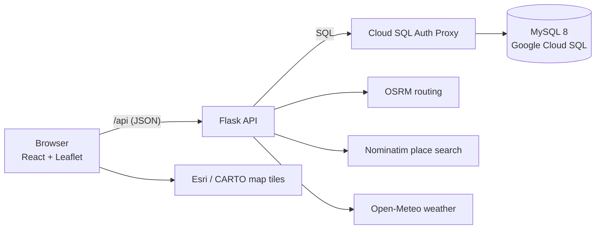

# team041-ReSQL

CS411 Course Project — Fall 2026

**Team ID:** team041
**Repository name:** fa26-cs411-team041-ReSQL
**Project:** Traffic Safety Risk Analyzer

| Member | Responsibility |
|---|---|
| Saravanan Rajendran (captain) | Creative component: the safest-route recommender |
| Praveen Ramesh Jayasree | Database and data ingestion |
| Adithyaa Veerabathiran Seran | Search & lookup |
| Sree Vinay Ravuru | CRUD & records: accounts, preferences, saved locations, crash reports |

## Project Overview

Federal crash databases record where crashes happen and how severe they are, but not what the weather was doing at the time, so it is hard to answer a simple question: which roads are dangerous, and under what conditions? Traffic Safety Risk Analyzer joins every fatal US crash (NHTSA FARS) with the readings of the nearest NOAA weather station on the crash date, and uses NHTSA CRSS national estimates to weigh how dangerous each weather and lighting combination is. Users can look up crash history for a place, route or region, broken down by weather, time of day and road type, along with a computed risk score.

**Creative component: safest-route recommender.** Given a start and a destination, the app compares several candidate routes and scores each one by the risk of the grid cells it passes through under the chosen conditions. It shows the **fastest**, the **safest** and a **balanced** option, where the balance between speed and safety comes from the user's own preference.

### What the app does

| Page | Features |
|---|---|
| **Analyze** | Route risk from A to B under current or chosen conditions (weather, time of day, season); fastest / safest / balanced options on the map; risk score, risk factors and risk over the day or year; works without an account |
| **Search** | Crash lookup by state and county or by the area shown on the map, filtered by weather, light, road type, year and month; crash details (when and where, reported weather and light, road type, people killed, vehicles and people involved) with the nearest station's weather that day |
| **Saved Routes** | Route history with the chosen option; saved locations (add, rename, delete); risk subscriptions with alerts when a location's score changes |
| **Reports** | Community crash and hazard reports: post, edit, delete; other users confirm or flag them; admins moderate and remove reports |
| **Profile** | Sign up and sign in; display name, units (miles or km), safety-vs-speed preference, password change, account deletion; light and dark mode |

### Current status

- The **risk score is a placeholder**, computed by the `CellRiskCurrent` view from the Stage 2 design. Each 0.1° grid cell (about 11 km) gets a 0–100 score for each of 8 weather × light conditions. The score is built from the cell's fatal crashes per year under that condition, weighted by how severe crashes under that condition are nationally (CRSS), plus community reports from the last 30 days. A route's score is the distance-weighted average of the cells it crosses. A machine-learning model will replace it later; the backend is ready for it (`RISK_MODEL=ml`, `backend/app/risk/ml.py`).
- Not built yet: the side-by-side comparison of several locations (proposal 6.1) and drive-mode assistance.

## Tech Stack

- **Frontend:** React 18, TypeScript, Vite 5, React Router, Leaflet / react-leaflet (maps), Recharts (charts), lucide-react (icons)
- **Backend:** Python, Flask 3 REST API, PyMySQL with hand-written SQL (no ORM), JWT sign-in (PyJWT), Werkzeug password hashing
- **Database:** MySQL 8 on Google Cloud SQL. The schema in `database/` has 23 tables in 3NF, CHECK constraints, foreign keys with delete rules, 6 triggers and the `CellRiskCurrent` view
- **Other tools/libraries:**
  - Data loading (`database/loader/load_data.py`): pandas, NumPy, scikit-learn (BallTree nearest-station search)
  - Outside services: OSRM (routing), Nominatim (place search), Open-Meteo (current weather), Esri and CARTO map tiles. The app falls back to built-in offline versions of the first three when they don't answer.
  - Testing: pytest, Vitest with Testing Library, and Playwright for end-to-end tests
  - Cloud SQL Auth Proxy for local development

### How the pieces fit



## Data

| Source | What we use | In the database |
|---|---|---|
| NHTSA FARS 2022–2024 | Every fatal crash on US public roads: location, date and time, police-reported weather and light, road type, vehicles, people | 112,975 crashes, 174,586 vehicles, 274,910 people |
| NOAA GHCN-Daily 2022–2024 | Daily precipitation, snowfall, snow depth, temperature and wind | 21,320 stations, 12.3 million daily readings |
| NHTSA CRSS 2024 | National estimates for crashes of every severity, by weather and light | 8 condition profiles |

Each crash is linked to a nearby weather station (within 50 km; 6.6 km on average) and that station's readings for the crash date; 99.9% of crashes have a station. Crashes and reports are placed on a 0.1° grid using `cell_id = FLOOR(lat*10)_FLOOR(lon*10)`. The full design and its normalization are in [`doc/stage2_database_design-p2.md`](doc/stage2_database_design-p2.md).

## Repository Structure

```
├── README.md            # This file
├── SETUP.md             # Full setup, Cloud SQL connection, commands and tests
├── TeamInfo.md          # Team details
├── doc/                 # Proposal, Stage 2 database design, ER diagram
├── images/              # UI mockup
├── frontend/            # React app
│   ├── src/             #   pages, components, API client, unit tests (*.test.ts[x])
│   └── e2e/             #   Playwright end-to-end tests
├── backend/             # Flask API
│   ├── app/             #   API routes (api/), risk models (risk/), routing/geocoding/weather services, jobs
│   ├── tests/           #   pytest tests
│   └── scripts/         #   smoke_test.py: checks a real database, such as Cloud SQL
└── database/            # schema.sql, triggers.sql, views.sql, seed_lookups.sql,
                         # demo_seed.sql (Illinois sample), loader/load_data.py (FARS + GHCN + CRSS loader)
```

## Setup Instructions

You need Python 3.10+, Node.js 18+ (20+ for the browser tests) and access to the team's Cloud SQL instance. [`SETUP.md`](SETUP.md) has every step in detail; this is the short version for Windows PowerShell.

1. Clone the repository:
   ```
   git clone https://github.com/cs411-alawini/fa26-cs411-team041-ReSQL.git
   cd fa26-cs411-team041-ReSQL
   ```
2. Set up the backend:
   ```powershell
   cd backend
   python -m venv .venv
   .venv\Scripts\activate             # macOS/Linux: source .venv/bin/activate
   pip install -r requirements-dev.txt
   copy .env.example .env             # then fill in DB_USER, DB_PASSWORD, DB_NAME=resql, JWT_SECRET
   ```
3. Set up the frontend:
   ```powershell
   cd ..\frontend
   npm install
   ```
4. Start the Cloud SQL Auth Proxy in its own window and leave it running. Install the Google Cloud CLI and run `gcloud auth application-default login` first.
   ```powershell
   .\cloud-sql-proxy.exe --port 3306 cs411-512805:REGION:INSTANCE
   ```
5. Check the connection and start the API from `backend`, with the venv active:
   ```powershell
   python scripts\smoke_test.py       # read-only check; should end with "0 failed"
   flask --app wsgi create-admin --email you@illinois.edu --password "..."   # optional admin account
   flask --app wsgi run               # API on http://127.0.0.1:5000
   ```
6. Start the web app from `frontend`, in another window:
   ```powershell
   npm run dev                        # open http://localhost:5173
   ```

To try the app without Cloud SQL, use a local MySQL and load the Illinois sample with `flask --app wsgi init-db --demo` (see SETUP.md, section 4).

## Tests

| Suite | Command | Count |
|---|---|---|
| Backend (pytest, against a local MySQL test database) | `cd backend; pytest` | 99 tests |
| Frontend unit tests (Vitest) | `cd frontend; npm test` | 44 tests |
| End-to-end (Playwright: real API, web app and a local MySQL) | `cd frontend; npm run test:e2e` | 16 tests, plus 3 more on a copy of real data |
| Smoke test against a real database | `cd backend; python scripts\smoke_test.py [--write]` | schema, data and every API endpoint |

The tests never touch Cloud SQL; they use local databases (see SETUP.md, section 3).

## Project Documents

- Stage 1 proposal: [`doc/Project_Proposal.md`](doc/Project_Proposal.md)
- Stage 2 database design: [`doc/stage2_database_design-p2.md`](doc/stage2_database_design-p2.md)
- ER diagram: [`doc/er_diagram.mmd`](doc/er_diagram.mmd)
- UI mockup: [`images/ui-mockup.png`](images/ui-mockup.png)
