# Stage 3: Database Implementation and Indexing

**Project:** Traffic Safety Risk Analyzer
**Team:** ReSQL (Team 041)
**Members:** Praveen Ramesh Jayasree, Adithyaa Veerabathiran Seran, Sree Vinay Ravuru, Saravanan Rajendran

This document covers the Stage 3 deliverables: the database implemented on Google Cloud Platform, the DDL for every table, the data we loaded, four advanced SQL queries, and an indexing analysis of each query. The schema is exactly the relational schema from our Stage 2 submission (section 5 of `stage2_database_design-p2.md`), including its CHECK constraints, unique keys and delete rules. We lost points in Stage 2, so we am including `stage2_revisions.md`.

---

## Part 1: Database Implementation

### 1.1 Platform and connection

The database runs on **Cloud SQL for MySQL 8.4.11** (`8.4.11-google`) in the GCP project `cs411-512805`, instance `resql-db` (Enterprise edition, region us-central1, single zone). We connect from Google Cloud Shell with the `mysql` command-line client. The database is called `resql` and holds 23 tables plus the `CellRiskCurrent` view.

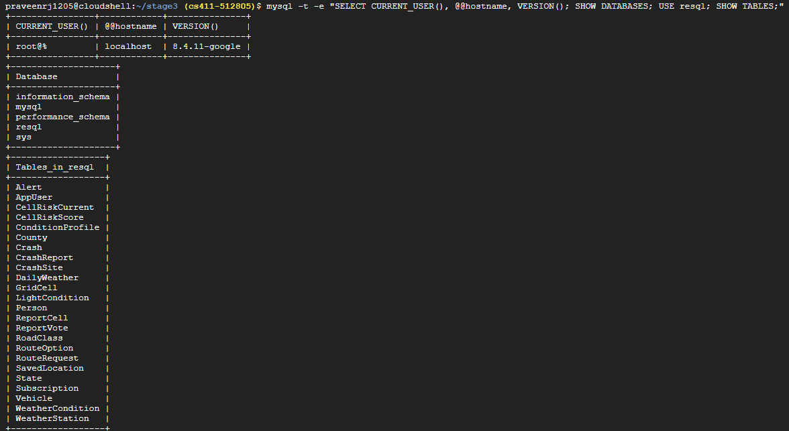

*Screenshot: `mysql -t -e "SELECT CURRENT_USER(), @@hostname, VERSION(); SHOW DATABASES; USE resql; SHOW TABLES;"` run from Cloud Shell against `resql-db`.*

### 1.2 Data Definition Language (DDL)

These are the exact commands we ran. Types, keys, CHECK constraints, unique pairs and ON DELETE rules follow Stage 2 sections 5 and 6. Only primary keys, UNIQUE constraints and the indexes InnoDB creates automatically for foreign keys exist after this script. Extra indexes are the subject of Part 2.

```sql
-- ReSQL: Traffic Safety Risk Analyzer
-- Stage 3 DDL. Implements the Stage 2 relational schema (section 5) with the
-- constraints of section 6. MySQL 8.0.16+ (CHECK constraints), InnoDB, utf8mb4.
-- Only primary keys, UNIQUE constraints and the indexes InnoDB builds for
-- foreign keys are created here. Extra indexes are added in the indexing study.

CREATE DATABASE IF NOT EXISTS resql CHARACTER SET utf8mb4 COLLATE utf8mb4_0900_ai_ci;
USE resql;

-- ---------- Reference data ----------
CREATE TABLE State (
  state_code   TINYINT      NOT NULL,
  state_name   VARCHAR(40)  NOT NULL,
  PRIMARY KEY (state_code)
);

CREATE TABLE County (
  state_code   TINYINT      NOT NULL,
  county_code  SMALLINT     NOT NULL,
  county_name  VARCHAR(60)  NOT NULL,
  PRIMARY KEY (state_code, county_code),
  FOREIGN KEY (state_code) REFERENCES State(state_code) ON DELETE RESTRICT
);

CREATE TABLE WeatherCondition (
  weather_code   TINYINT      NOT NULL,
  description    VARCHAR(60)  NOT NULL,
  weather_group  VARCHAR(20)  NOT NULL,
  PRIMARY KEY (weather_code),
  CHECK (weather_group IN ('dry','wet','snow_ice','low_visibility','unknown'))
);

CREATE TABLE LightCondition (
  light_code   TINYINT      NOT NULL,
  description  VARCHAR(60)  NOT NULL,
  light_group  VARCHAR(10)  NOT NULL,
  PRIMARY KEY (light_code),
  CHECK (light_group IN ('day','dark','unknown'))
);

CREATE TABLE RoadClass (
  func_sys_code  TINYINT      NOT NULL,
  description    VARCHAR(60)  NOT NULL,
  PRIMARY KEY (func_sys_code)
);

CREATE TABLE GridCell (
  cell_id        VARCHAR(12)   NOT NULL,
  min_latitude   DECIMAL(4,1)  NOT NULL,
  min_longitude  DECIMAL(5,1)  NOT NULL,
  PRIMARY KEY (cell_id),
  UNIQUE (min_latitude, min_longitude)
);

-- ---------- Weather (NOAA GHCN-Daily) ----------
CREATE TABLE WeatherStation (
  station_id    CHAR(11)      NOT NULL,
  station_name  VARCHAR(40)   NOT NULL,
  latitude      DECIMAL(7,4)  NOT NULL,
  longitude     DECIMAL(8,4)  NOT NULL,
  PRIMARY KEY (station_id)
);

CREATE TABLE DailyWeather (
  station_id        CHAR(11)      NOT NULL,
  obs_date          DATE          NOT NULL,
  precipitation_mm  DECIMAL(6,1)  NULL,
  snowfall_mm       DECIMAL(6,1)  NULL,
  snow_depth_mm     DECIMAL(6,1)  NULL,
  temp_max_c        DECIMAL(4,1)  NULL,
  temp_min_c        DECIMAL(4,1)  NULL,
  avg_wind_ms       DECIMAL(4,1)  NULL,
  PRIMARY KEY (station_id, obs_date),
  FOREIGN KEY (station_id) REFERENCES WeatherStation(station_id) ON DELETE CASCADE
);

-- ---------- Crashes (NHTSA FARS) ----------
CREATE TABLE CrashSite (
  latitude     DECIMAL(10,8)  NOT NULL,
  longitude    DECIMAL(11,8)  NOT NULL,
  state_code   TINYINT        NOT NULL,
  county_code  SMALLINT       NOT NULL,
  cell_id      VARCHAR(12)    NOT NULL,
  PRIMARY KEY (latitude, longitude),
  FOREIGN KEY (state_code, county_code) REFERENCES County(state_code, county_code) ON DELETE RESTRICT,
  FOREIGN KEY (cell_id) REFERENCES GridCell(cell_id) ON DELETE RESTRICT
);

CREATE TABLE Crash (
  data_year           SMALLINT        NOT NULL,
  st_case             INT             NOT NULL,
  latitude            DECIMAL(10,8)   NOT NULL,
  longitude           DECIMAL(11,8)   NOT NULL,
  crash_date          DATE            NOT NULL,
  crash_hour          TINYINT         NOT NULL,   -- 99 = unknown, as published by FARS
  crash_minute        TINYINT         NOT NULL,   -- 99 = unknown, as published by FARS
  weather_code        TINYINT         NOT NULL,
  light_code          TINYINT         NOT NULL,
  func_sys_code       TINYINT         NOT NULL,
  weather_station_id  CHAR(11)        NULL,
  rural_urban         TINYINT         NOT NULL,
  fatalities          SMALLINT        NOT NULL,
  persons_involved    SMALLINT        NOT NULL,
  vehicles_involved   SMALLINT        NOT NULL,
  PRIMARY KEY (data_year, st_case),
  FOREIGN KEY (latitude, longitude) REFERENCES CrashSite(latitude, longitude) ON DELETE RESTRICT,
  FOREIGN KEY (weather_code) REFERENCES WeatherCondition(weather_code) ON DELETE RESTRICT,
  FOREIGN KEY (light_code) REFERENCES LightCondition(light_code) ON DELETE RESTRICT,
  FOREIGN KEY (func_sys_code) REFERENCES RoadClass(func_sys_code) ON DELETE RESTRICT,
  FOREIGN KEY (weather_station_id, crash_date) REFERENCES DailyWeather(station_id, obs_date) ON DELETE RESTRICT,
  CHECK (YEAR(crash_date) = data_year)
);

CREATE TABLE Vehicle (
  data_year          SMALLINT  NOT NULL,
  st_case            INT       NOT NULL,
  veh_no             SMALLINT  NOT NULL,
  body_type          SMALLINT  NOT NULL,
  model_year         SMALLINT  NOT NULL,
  speeding_related   TINYINT   NOT NULL,
  deaths_in_vehicle  TINYINT   NOT NULL,
  PRIMARY KEY (data_year, st_case, veh_no),
  FOREIGN KEY (data_year, st_case) REFERENCES Crash(data_year, st_case) ON DELETE CASCADE
);

CREATE TABLE Person (
  data_year        SMALLINT  NOT NULL,
  st_case          INT       NOT NULL,
  veh_no           SMALLINT  NOT NULL,   -- 0 = non-motorist
  per_no           SMALLINT  NOT NULL,
  person_type      TINYINT   NOT NULL,
  injury_severity  TINYINT   NOT NULL,
  age              SMALLINT  NOT NULL,
  restraint_use    TINYINT   NOT NULL,
  PRIMARY KEY (data_year, st_case, veh_no, per_no),
  FOREIGN KEY (data_year, st_case) REFERENCES Crash(data_year, st_case) ON DELETE CASCADE
);

-- ---------- Scoring ----------
CREATE TABLE ConditionProfile (
  condition_id                TINYINT       NOT NULL,
  weather_group               VARCHAR(20)   NOT NULL,
  light_group                 VARCHAR(10)   NOT NULL,
  national_est_crashes        INT           NOT NULL,
  national_serious_fatal_pct  DECIMAL(5,2)  NOT NULL,
  PRIMARY KEY (condition_id),
  UNIQUE (weather_group, light_group),
  CHECK (weather_group IN ('dry','wet','snow_ice','low_visibility')),
  CHECK (light_group IN ('day','dark'))
);

CREATE TABLE CellRiskScore (
  cell_id         VARCHAR(12)  NOT NULL,
  condition_id    TINYINT      NOT NULL,
  crash_count     INT          NOT NULL,
  fatality_count  INT          NOT NULL,
  computed_at     DATETIME     NOT NULL,
  PRIMARY KEY (cell_id, condition_id),
  FOREIGN KEY (cell_id) REFERENCES GridCell(cell_id) ON DELETE CASCADE,
  FOREIGN KEY (condition_id) REFERENCES ConditionProfile(condition_id) ON DELETE CASCADE
);

-- ---------- Application ----------
CREATE TABLE AppUser (
  user_id        INT            NOT NULL AUTO_INCREMENT,
  email          VARCHAR(120)   NOT NULL,
  password_hash  VARCHAR(255)   NOT NULL,
  display_name   VARCHAR(60)    NOT NULL,
  role           VARCHAR(10)    NOT NULL DEFAULT 'user',
  safety_weight  DECIMAL(3,2)   NOT NULL DEFAULT 0.50,
  units          VARCHAR(10)    NOT NULL DEFAULT 'imperial',
  created_at     DATETIME       NOT NULL DEFAULT CURRENT_TIMESTAMP,
  PRIMARY KEY (user_id),
  UNIQUE (email),
  CHECK (role IN ('user','admin')),
  CHECK (units IN ('metric','imperial')),
  CHECK (safety_weight BETWEEN 0 AND 1)
);

CREATE TABLE SavedLocation (
  location_id  INT            NOT NULL AUTO_INCREMENT,
  user_id      INT            NOT NULL,
  label        VARCHAR(60)    NOT NULL,
  latitude     DECIMAL(9,6)   NOT NULL,
  longitude    DECIMAL(10,6)  NOT NULL,
  created_at   DATETIME       NOT NULL DEFAULT CURRENT_TIMESTAMP,
  PRIMARY KEY (location_id),
  FOREIGN KEY (user_id) REFERENCES AppUser(user_id) ON DELETE CASCADE,
  CHECK (latitude BETWEEN -90 AND 90),
  CHECK (longitude BETWEEN -180 AND 180)
);

CREATE TABLE CrashReport (
  report_id    INT            NOT NULL AUTO_INCREMENT,
  user_id      INT            NOT NULL,
  latitude     DECIMAL(9,6)   NOT NULL,
  longitude    DECIMAL(10,6)  NOT NULL,
  reason       VARCHAR(255)   NOT NULL,
  status       VARCHAR(20)    NOT NULL DEFAULT 'active',
  reported_at  DATETIME       NOT NULL DEFAULT CURRENT_TIMESTAMP,
  reviewed_by  INT            NULL,
  reviewed_at  DATETIME       NULL,
  PRIMARY KEY (report_id),
  FOREIGN KEY (user_id) REFERENCES AppUser(user_id) ON DELETE CASCADE,
  FOREIGN KEY (reviewed_by) REFERENCES AppUser(user_id) ON DELETE SET NULL,
  CHECK (status IN ('active','resolved','removed')),
  CHECK (latitude BETWEEN -90 AND 90),
  CHECK (longitude BETWEEN -180 AND 180)
);

CREATE TABLE ReportCell (
  report_id  INT          NOT NULL,
  cell_id    VARCHAR(12)  NOT NULL,
  PRIMARY KEY (report_id),
  FOREIGN KEY (report_id) REFERENCES CrashReport(report_id) ON DELETE CASCADE,
  FOREIGN KEY (cell_id) REFERENCES GridCell(cell_id) ON DELETE RESTRICT
);

CREATE TABLE ReportVote (
  report_id  INT       NOT NULL,
  user_id    INT       NOT NULL,
  vote       TINYINT   NOT NULL,
  voted_at   DATETIME  NOT NULL DEFAULT CURRENT_TIMESTAMP,
  PRIMARY KEY (report_id, user_id),
  FOREIGN KEY (report_id) REFERENCES CrashReport(report_id) ON DELETE CASCADE,
  FOREIGN KEY (user_id) REFERENCES AppUser(user_id) ON DELETE CASCADE,
  CHECK (vote IN (1, -1))
);

CREATE TABLE RouteRequest (
  route_id       INT            NOT NULL AUTO_INCREMENT,
  user_id        INT            NOT NULL,
  origin_lat     DECIMAL(9,6)   NOT NULL,
  origin_lon     DECIMAL(10,6)  NOT NULL,
  dest_lat       DECIMAL(9,6)   NOT NULL,
  dest_lon       DECIMAL(10,6)  NOT NULL,
  chosen_option  VARCHAR(10)    NULL,
  requested_at   DATETIME       NOT NULL DEFAULT CURRENT_TIMESTAMP,
  PRIMARY KEY (route_id),
  FOREIGN KEY (user_id) REFERENCES AppUser(user_id) ON DELETE CASCADE,
  CHECK (chosen_option IN ('fastest','safest','balanced')),
  CHECK (origin_lat BETWEEN -90 AND 90),
  CHECK (dest_lat BETWEEN -90 AND 90),
  CHECK (origin_lon BETWEEN -180 AND 180),
  CHECK (dest_lon BETWEEN -180 AND 180)
);

CREATE TABLE RouteOption (
  route_id       INT           NOT NULL,
  option_type    VARCHAR(10)   NOT NULL,
  travel_time_s  INT           NOT NULL,
  risk_score     DECIMAL(5,2)  NOT NULL,
  PRIMARY KEY (route_id, option_type),
  FOREIGN KEY (route_id) REFERENCES RouteRequest(route_id) ON DELETE CASCADE,
  CHECK (option_type IN ('fastest','safest','balanced')),
  CHECK (risk_score BETWEEN 0 AND 100)
);

CREATE TABLE Subscription (
  subscription_id  INT           NOT NULL AUTO_INCREMENT,
  location_id      INT           NOT NULL,
  condition_id     TINYINT       NOT NULL,
  alert_threshold  DECIMAL(5,2)  NOT NULL,
  baseline_score   DECIMAL(5,2)  NOT NULL,
  is_active        BOOLEAN       NOT NULL DEFAULT TRUE,
  created_at       DATETIME      NOT NULL DEFAULT CURRENT_TIMESTAMP,
  PRIMARY KEY (subscription_id),
  UNIQUE (location_id, condition_id),
  FOREIGN KEY (location_id) REFERENCES SavedLocation(location_id) ON DELETE CASCADE,
  FOREIGN KEY (condition_id) REFERENCES ConditionProfile(condition_id) ON DELETE RESTRICT,
  CHECK (alert_threshold > 0),
  CHECK (baseline_score BETWEEN 0 AND 100)
);

CREATE TABLE Alert (
  alert_id            INT           NOT NULL AUTO_INCREMENT,
  subscription_id     INT           NOT NULL,
  risk_score_at_send  DECIMAL(5,2)  NOT NULL,
  sent_at             DATETIME      NOT NULL DEFAULT CURRENT_TIMESTAMP,
  PRIMARY KEY (alert_id),
  FOREIGN KEY (subscription_id) REFERENCES Subscription(subscription_id) ON DELETE CASCADE,
  CHECK (risk_score_at_send BETWEEN 0 AND 100)
);

-- ---------- Risk score view (Stage 2, section 4.3) ----------
CREATE VIEW CellRiskCurrent AS
SELECT g.cell_id, p.condition_id,
       COALESCE(s.crash_count, 0)    AS crash_count,
       COALESCE(s.fatality_count, 0) AS fatality_count,
       COALESCE(r.recent_reports, 0) AS recent_reports,
       ROUND(100 * (1 - EXP(-(
             COALESCE(s.crash_count, 0) / y.years
               * p.national_serious_fatal_pct / b.avg_pct
           + 0.5 * COALESCE(r.recent_reports, 0)) / 2)), 2) AS risk_score
FROM GridCell g
CROSS JOIN ConditionProfile p
CROSS JOIN (SELECT COUNT(DISTINCT data_year) AS years FROM Crash) y
CROSS JOIN (SELECT AVG(national_serious_fatal_pct) AS avg_pct
            FROM ConditionProfile) b
LEFT JOIN CellRiskScore s
       ON s.cell_id = g.cell_id AND s.condition_id = p.condition_id
LEFT JOIN (SELECT rc.cell_id, COUNT(*) AS recent_reports
           FROM ReportCell rc
           JOIN CrashReport cr ON cr.report_id = rc.report_id
           WHERE cr.status <> 'removed'
             AND cr.reported_at >= NOW() - INTERVAL 30 DAY
             AND (SELECT COALESCE(SUM(v.vote), 0) FROM ReportVote v
                  WHERE v.report_id = cr.report_id) >= 0
           GROUP BY rc.cell_id) r
       ON r.cell_id = g.cell_id
WHERE s.cell_id IS NOT NULL OR r.cell_id IS NOT NULL;
```

**Note on two foreign-key indexes.** InnoDB builds an index for every foreign key automatically. During the indexing study we learned that when a new index starts with the same column as such an automatic index (for example `Crash(weather_code, ...)`), InnoDB silently drops its automatic index, and the new index can then no longer be dropped because the foreign key depends on it. To keep every experiment starting from the same baseline, we replaced the two affected automatic indexes with explicitly named but identical ones: `fk_crash_latlon ON Crash(latitude, longitude)` and `fk_crash_weather ON Crash(weather_code)`. They index exactly the same columns as the automatic indexes they replace, so the baseline is unchanged.

### 1.3 Where the data comes from

All crash, weather and baseline data is **real** and downloaded directly from the agencies in Cloud Shell. We loaded three FARS release years, 2022 to 2024, as Stage 2 describes ("several FARS release years side by side").

| Source | Files used | Loaded into |
|---|---|---|
| NHTSA FARS 2022, 2023, 2024 | `accident.csv`, `vehicle.csv`, `person.csv` | State, County, WeatherCondition, LightCondition, RoadClass, GridCell, CrashSite, Crash, Vehicle, Person |
| NOAA GHCN-Daily 2022, 2023, 2024 | `by_year/<year>.csv.gz`, `ghcnd-stations.txt` | WeatherStation, DailyWeather |
| NHTSA CRSS 2022, 2023, 2024 | `accident.csv` (weighted) | ConditionProfile (national baselines) |
| Synthetic (Generated by us) | none | AppUser, SavedLocation, CrashReport, ReportCell, ReportVote, RouteRequest, RouteOption, Subscription, Alert |

**The application tables are auto-generated**, as the assignment allows, because the application has no real users yet. The generator follows every Stage 2 rule (allowed values, one vote per user per report, no voting on your own report, only admins review reports and every removed report has a reviewer, a chosen route option was actually offered, subscriptions unique per location and condition, alerts after their subscription). Report and saved-location coordinates are placed near real FARS crash sites, so the user data interacts with the real data in queries such as Q4.

What `etl.py` does to the real data (every number below is printed in `etl_report.txt`):

- **Invalid coordinates.** 513 of 113,488 FARS crashes use NHTSA's placeholder coordinates (77.7777, 88.8888, 99.9999) and were dropped, along with their vehicles and people. 112,975 crashes remain.
- **Crash sites and grid cells.** The 112,975 crashes occupy 112,876 distinct coordinate pairs (92 pairs carry more than one crash). No coordinate pair maps to more than one county, which confirms the dependency Stage 2 declared. Using the Stage 2 cell formula, the sites fall in 27,976 grid cells. 45 more cells were created for user reports that landed outside any crash cell, giving 28,021.
- **Weather.** From 78,568 US stations, each crash was matched to the nearest station within 50 km that recorded precipitation on the crash date (Stage 2 section 2.4). 112,822 of 112,975 crashes (99.9%) found a match. The median distance is 4.90 km and the 95th percentile is 18.36 km. All daily readings of the 21,320 matched stations for 2022 to 2024 were pivoted to one row per station-day, with units converted, `-9999` stored as NULL, and quality-flagged values (19,729 / 19,071 / 17,304 per year) stored as NULL.
- **Lookup groups.** Weather codes: 1, 6, 10 = dry; 2, 12 = wet; 3, 4, 11 = snow_ice; 5, 7 = low_visibility; 8, 98, 99 = unknown. Light codes: 1, 4, 5 (daylight, dawn, dusk) = day; 2, 3, 6 = dark; 7, 8, 9 = unknown.
- **National baselines.** `ConditionProfile` holds the CRSS-weighted crash estimate (total over 2022 to 2024) and the weighted share of crashes whose most severe injury was serious (A) or fatal (K), using CRSS's imputed weather and light columns. Dark and foggy is the most severe condition nationally (5.21%), and dry daylight is 2.75%.
- **Person rows of parked vehicles.** 1,283 Person rows have a vehicle number that does not exist in `vehicle.csv`. We checked all of them against FARS `parkwork.csv`: every one is an occupant of a parked or working vehicle, which `vehicle.csv` does not contain. Our Stage 2 trigger rule requires a nonzero `veh_no` to name an existing Vehicle, so these rows were not loaded. As a result, 159 crashes have a stored `fatalities` count higher than their number of fatal Person rows. We keep NHTSA's official `fatalities` value, since those deaths really happened.

### 1.4 Row counts
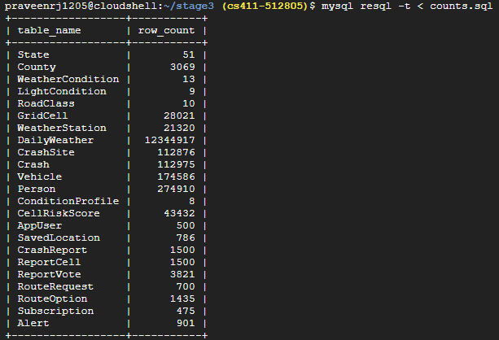

*Screenshot: `mysql resql -t < counts.sql`, one `COUNT(*)` per table.*

| Table | Rows | Source |
|---|---:|---|
| DailyWeather | 12,344,917 | GHCN-Daily |
| Person | 274,910 | FARS |
| Vehicle | 174,586 | FARS |
| Crash | 112,975 | FARS |
| CrashSite | 112,876 | FARS (derived) |
| CellRiskScore | 43,432 | scoring job over Crash |
| GridCell | 28,021 | derived |
| WeatherStation | 21,320 | GHCN-Daily |
| ReportVote | 3,821 | synthetic |
| County | 3,069 | FARS |
| CrashReport / ReportCell | 1,500 / 1,500 | synthetic |
| RouteOption | 1,435 | synthetic |
| Alert | 901 | synthetic |
| SavedLocation | 786 | synthetic |
| RouteRequest | 700 | synthetic |
| AppUser | 500 | synthetic |
| Subscription | 475 | synthetic |
| State, WeatherCondition, LightCondition, RoadClass, ConditionProfile | 51, 13, 9, 10, 8 | FARS / CRSS |

Thirteen tables hold more than 1,000 rows. Seven of them come from real data (DailyWeather, Person, Vehicle, Crash, CrashSite, WeatherStation, County) and two are derived from it (GridCell, CellRiskScore). Every count matches the number of rows `etl.py` wrote, so `LOAD DATA` skipped nothing.

---

## Part 1 (continued): Advanced Queries

Each query is part of a feature from our proposal and uses at least two of the required concepts. All four were run on the full database. Each screenshot shows the top 15 rows (`LIMIT 15`).

### Query 1: County risk profile for a state (search feature)

**Concepts:** join of five relations, aggregation via GROUP BY (with HAVING).

For every Illinois county with at least 20 fatal crashes in 2023 and 2024, the query returns the number of crashes and deaths, deaths per crash, and the share of crashes that happened in the dark and in wet or snowy weather. This is what the search page shows when a user picks a state: which counties are worst and under what conditions. The state and date range are parameters in the application.

```sql
-- Q1  County risk profile for one state (search page).
-- Concepts: join of 5 relations + aggregation via GROUP BY (with HAVING).
-- For every Illinois county with at least 20 fatal crashes in 2023-2024: crashes, deaths,
-- deaths per crash, and the share of crashes that happened in the dark and in wet/snowy weather.
SELECT co.county_name,
       COUNT(*)                                                AS crashes,
       SUM(c.fatalities)                                       AS deaths,
       ROUND(SUM(c.fatalities) / COUNT(*), 2)                  AS deaths_per_crash,
       ROUND(100 * AVG(l.light_group = 'dark'), 1)             AS pct_dark,
       ROUND(100 * AVG(w.weather_group IN ('wet','snow_ice')), 1) AS pct_wet_or_snow
FROM Crash c
JOIN CrashSite s         ON s.latitude = c.latitude AND s.longitude = c.longitude
JOIN County co           ON co.state_code = s.state_code AND co.county_code = s.county_code
JOIN LightCondition l    ON l.light_code = c.light_code
JOIN WeatherCondition w  ON w.weather_code = c.weather_code
WHERE s.state_code = 17
  AND c.crash_date BETWEEN '2023-01-01' AND '2024-12-31'
GROUP BY co.state_code, co.county_code, co.county_name
HAVING COUNT(*) >= 20
ORDER BY crashes DESC
LIMIT 15;
```

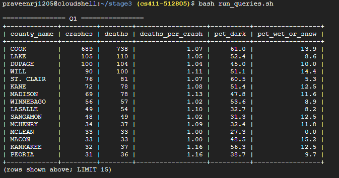

The query returns 15 rows (19 counties pass the HAVING filter). Cook County leads with 689 crashes and 738 deaths, 61.0% of them in the dark. Every county in the top 15 except McLean had at least 5% of its fatal crashes in wet or snowy weather.

### Query 2: Officer-reported weather vs. measured weather, by state

**Concepts:** join of five relations (including the composite foreign key from `Crash` into `DailyWeather`), aggregation via GROUP BY.

For crashes whose matched weather station measured at least 2.5 mm of precipitation that day, the query counts how often the officer still recorded dry weather. This is the cross-check our proposal promised between the two data sources. It tells us how much the FARS weather code alone would understate wet-road risk, which is why the risk score uses measured weather as well.

```sql
-- Q2  Officer-reported weather vs. measured weather, by state.
-- Concepts: join of 5 relations (incl. the composite FK into DailyWeather) + GROUP BY.
-- Among crashes whose matched station measured at least 2.5 mm of rain that day, how many did the
-- officer still record as dry weather? Shows where the reported weather code understates wet roads.
SELECT st.state_name,
       COUNT(*)                                             AS crashes_on_wet_days,
       SUM(w.weather_group = 'dry')                         AS reported_dry,
       ROUND(100 * SUM(w.weather_group = 'dry') / COUNT(*), 1) AS pct_reported_dry,
       ROUND(AVG(d.precipitation_mm), 1)                    AS avg_precip_mm
FROM Crash c
JOIN DailyWeather d      ON d.station_id = c.weather_station_id AND d.obs_date = c.crash_date
JOIN WeatherCondition w  ON w.weather_code = c.weather_code
JOIN CrashSite s         ON s.latitude = c.latitude AND s.longitude = c.longitude
JOIN State st            ON st.state_code = s.state_code
WHERE d.precipitation_mm >= 2.5
GROUP BY st.state_code, st.state_name
ORDER BY crashes_on_wet_days DESC
LIMIT 15;
```

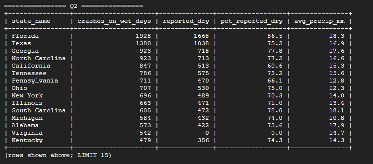

The query returns 15 rows. Across the top states, 61% to 87% of crashes on measurably wet days were recorded as dry, which fits the known limitation of daily data: it rained that day, but not necessarily at the hour of the crash. **Virginia shows 0 crashes reported as dry.** We checked this rather than assume a bug: Virginia leaves the weather field as "Not Reported" (code 98) on 2,364 of its crashes and has no crashes coded Clear or Cloudy at all (its only "dry"-group crashes are 2 with severe crosswinds). So its fair-weather crashes end up as "unknown", never as "dry". This is a data-quality finding about FARS that the application should show users.

### Query 3: Wet-or-icy-and-dark hotspot cells

**Concepts:** join of six relations, aggregation via GROUP BY, and a subquery in HAVING that cannot be replaced by a join.

The query finds grid cells whose number of fatal crashes in wet or snowy darkness is more than three times the average over all cells that had at least one such crash. These are the places the route planner should avoid on a rainy night. The subquery computes one national average over all groups and each group is compared with it. A join cannot express this, because the comparison value is an aggregate of the aggregates, not a row of another table.

```sql
-- Q3  Wet-or-icy-and-dark hotspot cells.
-- Concepts: join of 6 relations + GROUP BY + a subquery in HAVING (the national average per cell),
-- which cannot be replaced by a join because it compares each group with an aggregate of all groups.
-- Grid cells whose number of fatal crashes in wet or snowy darkness is more than 3 times the
-- average over all cells that had at least one such crash.
SELECT cs.cell_id,
       g.min_latitude, g.min_longitude,
       MIN(st.state_name)  AS state_name,
       COUNT(*)            AS crashes,
       SUM(c.fatalities)   AS deaths
FROM Crash c
JOIN CrashSite cs        ON cs.latitude = c.latitude AND cs.longitude = c.longitude
JOIN GridCell g          ON g.cell_id = cs.cell_id
JOIN State st            ON st.state_code = cs.state_code
JOIN WeatherCondition w  ON w.weather_code = c.weather_code
JOIN LightCondition l    ON l.light_code = c.light_code
WHERE w.weather_group IN ('wet','snow_ice')
  AND l.light_group = 'dark'
GROUP BY cs.cell_id, g.min_latitude, g.min_longitude
HAVING COUNT(*) > 3 * (
    SELECT AVG(t.n) FROM (
        SELECT COUNT(*) AS n
        FROM Crash c2
        JOIN CrashSite s2        ON s2.latitude = c2.latitude AND s2.longitude = c2.longitude
        JOIN WeatherCondition w2 ON w2.weather_code = c2.weather_code
        JOIN LightCondition l2   ON l2.light_code = c2.light_code
        WHERE w2.weather_group IN ('wet','snow_ice') AND l2.light_group = 'dark'
        GROUP BY s2.cell_id) t)
ORDER BY crashes DESC, deaths DESC
LIMIT 15;
```

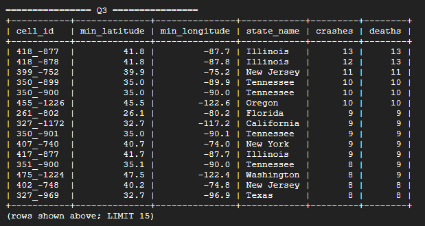

The query returns 15 rows. 4,908 fatal crashes happened in wet or snowy darkness, spread over 3,424 cells (an average of 1.43 per cell), and 106 cells exceed three times that average. The top cells are in Chicago (41.8, -87.7 and -87.8), the Philadelphia and Camden area, Portland, Memphis, San Diego, Fort Lauderdale and New York City.

### Query 4: Historical hotspots with fresh community reports

**Concepts:** SET operator (UNION ALL), aggregation via GROUP BY, joins.

The query combines two sources in one result: cells with at least three fatal crashes in 2023 and 2024 (FARS), and cells with user reports from the last 30 days that were not removed by a moderator. The outer GROUP BY keeps only cells present in both branches. These are the cells where historical risk and current community reports agree, which is what the alert feature should prioritise.

```sql
-- Q4  Cells to watch: historical hotspots that also have fresh community reports.
-- Concepts: SET operator (UNION ALL) + GROUP BY + joins.
-- Branch 1: cells with at least 3 fatal crashes in 2023-2024 (FARS).
-- Branch 2: cells with user reports in the last 30 days that were not removed.
-- The outer GROUP BY keeps cells present in both branches.
SELECT t.cell_id, g.min_latitude, g.min_longitude,
       MAX(t.fatal_crashes)  AS fatal_crashes_2023_24,
       MAX(t.recent_reports) AS reports_last_30_days
FROM (
    SELECT cs.cell_id, COUNT(*) AS fatal_crashes, 0 AS recent_reports
    FROM Crash c
    JOIN CrashSite cs ON cs.latitude = c.latitude AND cs.longitude = c.longitude
    WHERE c.crash_date >= '2023-01-01'
    GROUP BY cs.cell_id
    HAVING COUNT(*) >= 3
  UNION ALL
    SELECT rc.cell_id, 0, COUNT(*)
    FROM ReportCell rc
    JOIN CrashReport r ON r.report_id = rc.report_id
    WHERE r.status <> 'removed'
      AND r.reported_at >= NOW() - INTERVAL 30 DAY
    GROUP BY rc.cell_id
) t
JOIN GridCell g ON g.cell_id = t.cell_id
GROUP BY t.cell_id, g.min_latitude, g.min_longitude
HAVING MAX(t.fatal_crashes) > 0 AND MAX(t.recent_reports) > 0
ORDER BY reports_last_30_days DESC, fatal_crashes_2023_24 DESC
LIMIT 15;
```

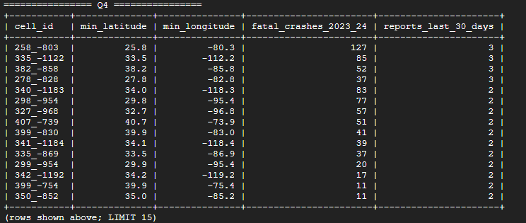

The query returns 15 rows. 6,856 cells have at least three fatal crashes in 2023 and 2024, 409 cells have recent reports, and 266 cells appear in both. The top results are in Miami, Phoenix, Louisville and the Tampa Bay area. The user reports are synthetic (section 1.3), so the counts in the second column show that the query works, not real community activity.

---

## Part 2: Indexing Analysis

### 2.1 Method

Each query is first measured with **only the primary-key and foreign-key indexes** (the baseline). Then each index design is created on its own, `ANALYZE TABLE` refreshes the statistics, `EXPLAIN ANALYZE` measures the query, and the design is dropped before the next one, so designs never stack. We compare the **estimated cost** reported by the optimizer, as the assignment recommends, rather than the run time. The headline number is the cost on the highest plan node that reports one. Because a cost change does not by itself show *why* a plan changed, we also read every plan to see whether the new index was used at all.

One effect appears in several results below and is worth explaining once. InnoDB builds its table statistics by sampling a small number of random index pages. Each `ANALYZE TABLE` therefore produces slightly different row estimates, and the optimizer can pick a different join order or price the same plan differently even when the new index is never touched. Whenever a plan does not use the new index, we treat its cost change as a statistics effect, not an index effect.

### 2.2 Query 1: County risk profile

**Baseline (cost 1,946).** The optimizer starts from `CrashSite` with a covering lookup on the foreign-key index `(state_code, county_code)` for `state_code = 17` (3,368 sites). For each site it finds the crash through `fk_crash_latlon` and applies the date filter, then reads `LightCondition`, `WeatherCondition` and `County` by primary key. The date filter has no index, so the optimizer guesses its selectivity at 11.4% and estimates 383 rows. In reality 2,226 rows pass (66%), because 2023 and 2024 are two of our three years.

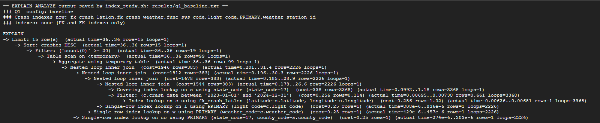

| Design | Index | Cost | Change | Used in plan? |
|---|---|---:|---:|---|
| A | `Crash(crash_date)` | 2,902 | +49.1% | No |
| B | `Crash(latitude, longitude, crash_date)` | 2,192 | +12.6% | No |
| C | `WeatherCondition(weather_group)`, `LightCondition(light_group)` | 1,876 | -3.6% | No |

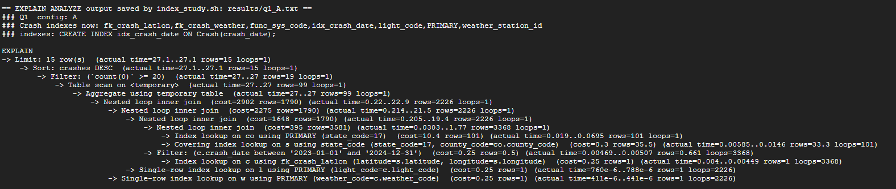
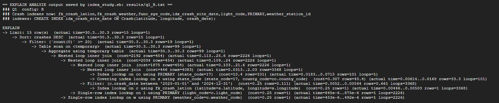
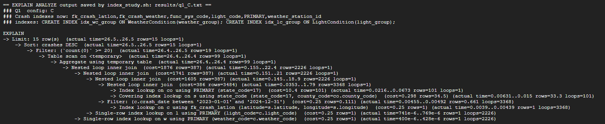

**Design A** indexes the column of the date filter. The optimizer does not use it to read `Crash`: a range covering two thirds of the table is cheaper to check row by row after the join than to read through a secondary index. The cost still rises, for an instructive reason. With an index on `crash_date`, the optimizer can estimate the date range from real statistics instead of guessing, so it now expects 50% of rows to pass (0.5 per site) instead of 11.4%. A more honest estimate means more rows flowing into the later joins (1,790 instead of 383), hence a higher cost for the same work. The plan also switches to starting from `County`, an effect of the new statistics.

**Design B** puts the date into the join index, so the join could check the date inside the index. The optimizer still chose `fk_crash_latlon`, because each site has about one crash and a date check on one row is cheap either way. The cost change comes only from re-sampled statistics: the plan now starts from `County` and estimates 4,083 sites instead of 3,368, for the same 3,368 sites actually read.

**Design C** indexes the group columns of the two lookup tables. Q1 never filters on them, it only reads them in `AVG(...)` after a primary-key lookup, so the indexes are not used. The 3.6% drop is statistics noise. The plan reads the same rows through the same indexes and differs from the baseline only in its re-sampled row estimates and its starting table (`County` instead of `CrashSite`, an equivalent order).

**Conclusion for Q1.** No design improved Q1. The query is already efficient with the default indexes: it touches only Illinois sites (3% of all sites) through the existing foreign-key index, and each following join is a primary-key lookup. Its remaining filter, the date range, is not selective enough for an index to pay off. Indexing would only help if the application queried short date ranges, such as one month.

### 2.3 Query 2: Reported vs. measured weather

**Baseline (cost 119,199).** This is our most expensive query, because it touches every matched crash (112,822) and looks up each one's reading in the 12.3-million-row `DailyWeather` through the primary key `(station_id, obs_date)`. Only after that lookup can it check `precipitation_mm >= 2.5`, which 18,916 crashes pass. The plan starts from `State` (51 rows), goes through `CrashSite` by its foreign-key index and `Crash` by `fk_crash_latlon`, and then probes `WeatherCondition` and `DailyWeather` by primary key.

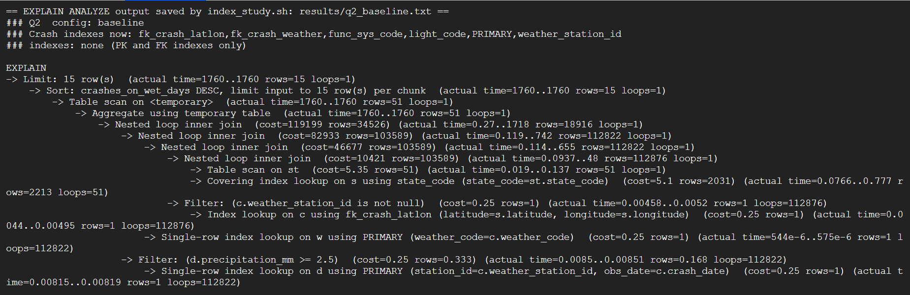

| Design | Index | Cost | Change | Used in plan? |
|---|---|---:|---:|---|
| A | `DailyWeather(precipitation_mm)` | 145,068 | +21.7% | No |
| B | `WeatherCondition(weather_group)` | 135,947 | +14.1% | No |
| C | `DailyWeather(obs_date, precipitation_mm)` | 145,068 | +21.7% | No |

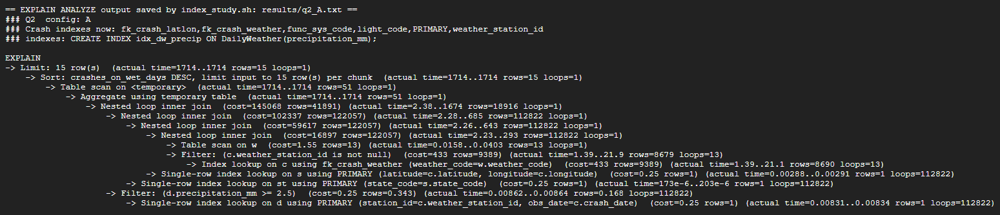
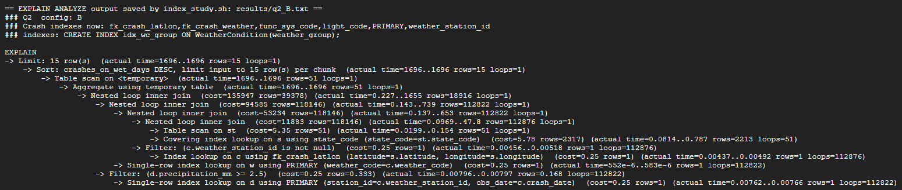
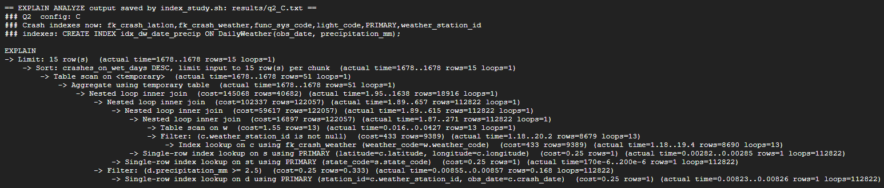

**Design A** indexes the filtered column. Using it would mean starting from every station-day in the country with at least 2.5 mm of rain (millions of rows over three years) and then searching for crashes on each. Starting from 112,822 crashes and probing the primary key is far cheaper, so the optimizer ignores the index.

**Design B** indexes the group column the query aggregates. `WeatherCondition` has 13 rows and is always reached by primary key, so there is nothing for the index to do.

**Design C** indexes the date together with precipitation, in case the optimizer wanted to scan rainy days in date order. It did not use it either: the join still needs `station_id`, which this index cannot supply first.

All three costs are higher than the baseline although none of the indexes appears in the plan. With A and C, the refreshed statistics made the optimizer estimate more matching crashes (122,057 instead of 103,589), and it switched to starting from `WeatherCondition` and reading crashes by `fk_crash_weather`. That order is priced higher (145,068) but reads the same rows in practice. With B, the plan keeps the baseline order with higher row estimates (118,146 instead of 103,589). **Conclusion for Q2:** the cost is dominated by one unavoidable primary-key lookup per crash into `DailyWeather`, and that lookup already uses the best possible index. To make Q2 cheaper, the measured precipitation would have to be stored on the crash row, which our Stage 2 normalization deliberately avoids (section 4.5), or the result could be precomputed by the batch job.

### 2.4 Query 3: Wet-or-icy-and-dark hotspot cells

**Baseline (cost 3,901).** The optimizer filters `WeatherCondition` (5 wet or snowy codes) and `LightCondition` (3 dark codes) by scanning them, combines them, and for each weather code reads matching crashes through the foreign-key index `fk_crash_weather`. Light code is then checked on the full row: it reads 1,742 crashes per weather code to keep 327 (cost 406 per lookup group). The same work runs twice, once in the main query and once in the subquery.

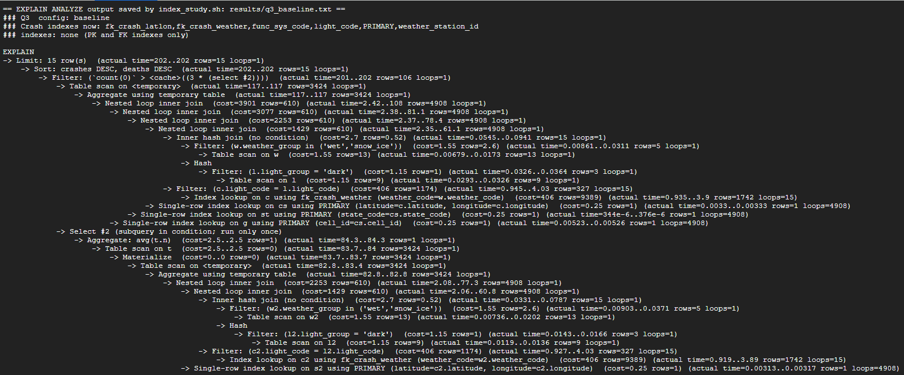

| Design | Index | Cost | Change | Used in plan? |
|---|---|---:|---:|---|
| A | `WeatherCondition(weather_group)`, `LightCondition(light_group)` | 29,171 | +647.8% | Yes |
| B | `Crash(weather_code, light_code)` | 3,409 | -12.6% | Yes |
| C | `Crash(weather_code, light_code, latitude, longitude, fatalities)` | **3,092** | **-20.7%** | Yes |

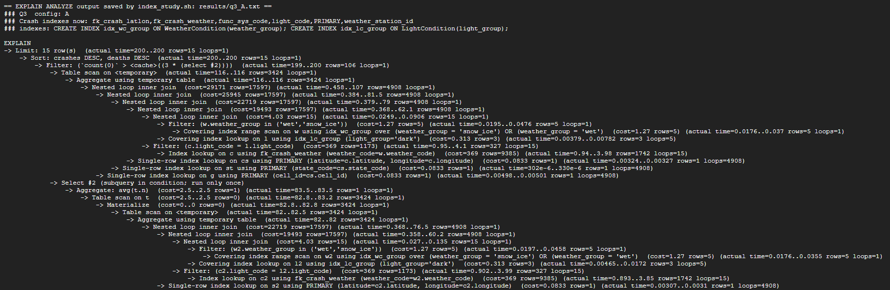
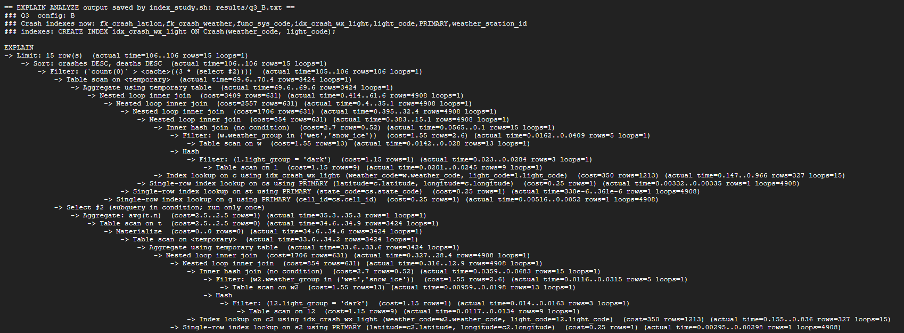
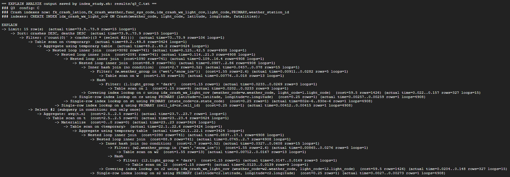

**Design A** is the clearest example in our study that a higher cost can mean a *better estimate* rather than a slower plan. The group indexes are used: both lookup tables are read by covering index lookups. But with real statistics on the group columns, the optimizer now knows that 5 x 3 = 15 code combinations qualify, and it multiplies them by about 1,173 crashes each, giving 17,597 estimated rows instead of the baseline's guess of 610. The actual work is identical, 4,908 crashes read and a run time of about 200 ms in both cases. The estimate is simply closer to the truth (4,908). Because cost is a function of estimated rows, it rose by 648% without the query doing any more work. The indexes give no benefit on 13-row and 9-row tables.

**Design B** lets the optimizer look up crashes by weather code *and* light code together, so it no longer reads the 1,742 crashes per weather code and discards most of them. It reads the 327 that match directly. The access cost for `Crash` falls from 406 to 350 and the total from 3,901 to 3,409 (-12.6%).

**Design C** extends B into a covering index. Besides the two codes, it holds the join columns `latitude, longitude` and the summed column `fatalities`, so the query never has to read the `Crash` row itself. The plan shows "Covering index lookup on c using idx_crash_wx_light_cov", and the access cost for `Crash` falls from 406 to 59.5 (-85%) in both the main query and the subquery. The total falls to 3,092 (-20.7%), and the measured time dropped from about 200 ms to 74 ms. The remaining cost is the primary-key lookups into `CrashSite`, `State` and `GridCell`, which are already optimal.

### 2.5 Query 4: Historical hotspots with fresh reports

**Baseline (cost 9,501).** The top-level cost hides most of the work here. MySQL estimates the materialized `UNION ALL` result as 0 rows ("Union all materialize (cost=0..0 rows=0)"), so the top cost barely reacts to changes inside the branches. The real work is visible inside the two branches. Branch 1 scans all of `Crash` (cost 11,385) to keep the 73,767 crashes since 2023, joins them to `CrashSite` and groups them by cell (cost 24,525). Branch 2 scans the 1,500-row `CrashReport` table (cost 62.5) and joins 432 recent, non-removed reports to `ReportCell` (cost 220). We therefore compare both the top cost and the branch costs.

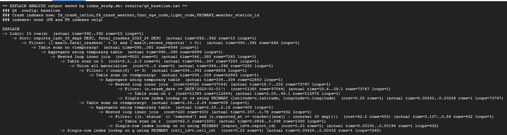

| Design | Index | Top cost | Change | Branch cost (baseline -> design) | Used in plan? |
|---|---|---:|---:|---|---|
| A | `CrashReport(reported_at)` | 9,499 | 0.0% | branch 2: 220 -> 304 | No |
| B | `CrashReport(status, reported_at)` | 9,501 | 0.0% | branch 2: 220 -> 357 | Yes (covering range scan) |
| C | `Crash(crash_date, latitude, longitude)` | 14,198 | +49.4% | branch 1: 24,525 -> 31,122 | Yes (covering range scan) |

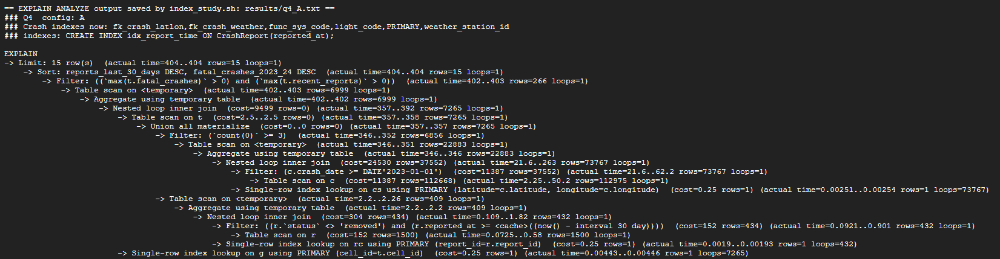
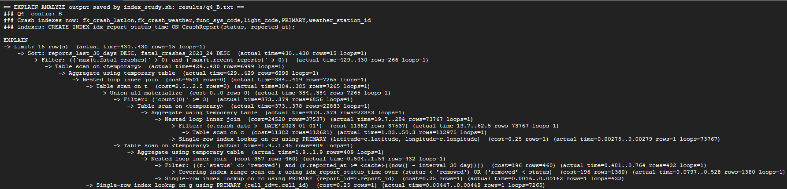
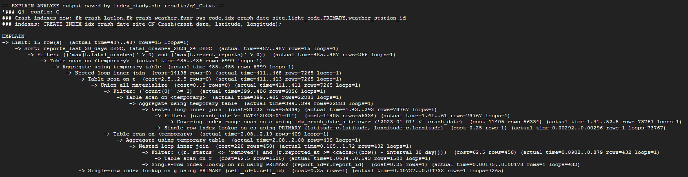

**Design A** targets the 30-day window, but the optimizer still scans the whole table. The window is not computed until the query runs (`NOW() - INTERVAL 30 DAY`), and 432 of 1,500 reports (29%) fall in it, too many for an index to beat a scan of a 1,500-row table. The branch-2 cost rose from 220 to 304 only because re-analysis changed the table-scan estimate (62.5 -> 152). Nothing in the plan changed.

**Design B** puts `status` first so the `<> 'removed'` condition could use the index. The optimizer did use it, as a covering range scan over every status except 'removed'. But that range holds 1,380 of 1,500 rows, so it is barely selective, and the estimated branch cost (357) is higher than the plain scan's. The top cost does not move, because the union result is estimated at 0 rows either way.

**Design C** covers branch 1: with `crash_date` first and the join columns after it, the date filter becomes a covering index range scan. But "since 2023" selects 65% of crashes, so the range scan reads almost as much as the table scan. Its better statistics also raise the estimated rows from 37,544 to 56,334 (actual: 73,767), so branch 1's cost rose to 31,122 and the top cost to 14,198 (+49.4%).

**Conclusion for Q4.** No design improved Q4. Branch 2 works on a small table where a full scan is already cheap. Branch 1's filter keeps two thirds of the table, and its real cost is grouping 73,767 crashes by cell, which no index on these columns removes. If `CrashReport` grows to hundreds of thousands of real reports, a `reported_at` index would become worthwhile, because a 30-day window would then be a small fraction of the table.

### 2.6 Summary and final index design

| Query | Baseline | Design A | Design B | Design C | New index used? |
|---|---:|---:|---:|---:|---|
| Q1 | 1,946 | 2,902 (+49.1%) | 2,192 (+12.6%) | 1,876 (-3.6%) | No, in all three |
| Q2 | 119,199 | 145,068 (+21.7%) | 135,947 (+14.1%) | 145,068 (+21.7%) | No, in all three |
| Q3 | 3,901 | 29,171 (+647.8%) | 3,409 (-12.6%) | **3,092 (-20.7%)** | Yes, in all three |
| Q4 | 9,501 | 9,499 (0.0%) | 9,501 (0.0%) | 14,198 (+49.4%) | Only B and C |

**Final design: one new index, `idx_crash_wx_light_cov ON Crash(weather_code, light_code, latitude, longitude, fatalities)`, which also replaces the now-redundant single-column foreign-key index `fk_crash_weather`.** (`stage3/final_indexes.sql`)

We chose it because it is the only design in the study that lowered cost through a better plan rather than through re-sampled statistics. In Q3 it cut the cost of reading `Crash` from 406 to 59.5 per lookup group (-85%) and the whole query from 3,901 to 3,092 (-20.7%), with the same 4,908 rows read. It does so by turning a two-step access (find rows by weather code, then filter light code from the table) into one index lookup on both codes that also carries every column the query needs. The same access pattern, "crashes under condition X", is what our risk-score job and the condition filters on the search page run, so the index helps beyond this one query. Since it starts with `weather_code`, it also enforces the `weather_code` foreign key, so keeping `fk_crash_weather` next to it would only cost space and write time.

We did **not** add the other candidates, because the measurements give no reason to. `Crash(crash_date)` and `Crash(latitude, longitude, crash_date)` were either ignored or made the plan more expensive: our date ranges cover two of the three loaded years, so a date index selects too much of the table to beat the existing access path. Indexes on `DailyWeather.precipitation_mm` and on the lookup-group columns were never used in Q1 or Q2, and the group indexes inflated Q3's estimate. `CrashReport(reported_at)` and `CrashReport(status, reported_at)` brought no gain at 1,500 rows. This changes the index plan we wrote in Stage 2 section 6.5, which was a design-time guess: we now replace the planned `Crash(weather_code, light_code)` with the covering version, and we postpone `Crash(crash_date)` and `CrashReport(reported_at)` until a query shows a measurable gain, for example once the report table grows with real users. The two remaining Stage 2 candidates, `Alert(subscription_id, sent_at)` and `RouteRequest(user_id, requested_at)`, serve the alert job and route history, which none of these four queries exercises. Their leading columns are already indexed as foreign keys, and we will measure them when those Stage 4 queries exist.

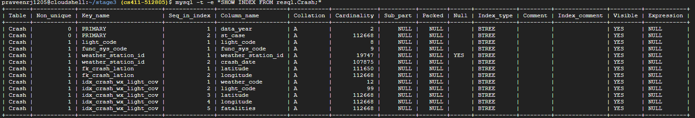

*Screenshot:  showing the indexes on `Crash` after the final design is applied.*
